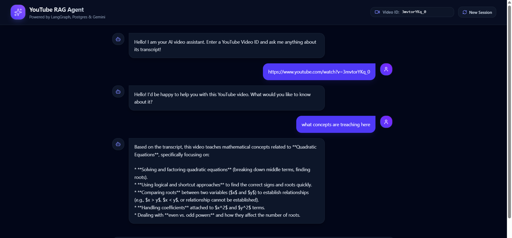
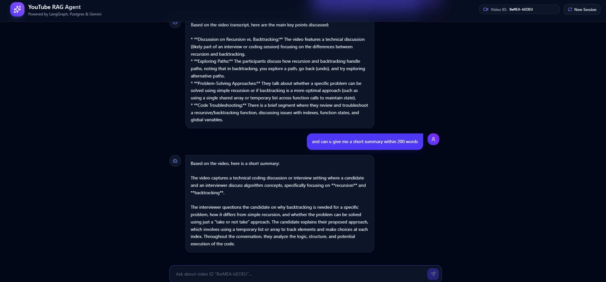

# 🚀 YouTube AI RAG Assistant & Chatbot

An intelligent, production-grade Retrieval-Augmented Generation (RAG) agent that ingests YouTube video transcripts and enables users to interactively chat, summarize, and ask targeted questions about any video in real time. Built using a modern full-stack architecture with local embedded pipelines for zero-cost scalability.

---

## 🌐 Live Link

* **Live Application:** [https://rag-ai-chat-with-yt.vercel.app](https://rag-ai-chat-with-yt.vercel.app)

---

## 📸 Screenshots

| Application Interface | AI Transcript Ingestion & Chat |
| :---: | :---: |
|  |  |

---

## 📊 Core Features & Capabilities

* **🎬 Automated Transcript Extraction:** Instantly fetches video transcripts from YouTube video URLs or IDs using optimized RapidAPI endpoints.
* **🧠 Local Vector Embeddings:** Utilizes `@xenova/transformers` (`all-MiniLM-L6-v2`) locally to compute 384-dimensional vector embeddings without hitting external rate limits or API quotas.
* **⚡ Vector Search Engine:** Connects to Neon PostgreSQL powered by `PGVector` for high-performance cosine similarity searches over vectorized text chunks.
* **🤖 Agentic AI Capabilities:** Powered by LangGraph and Google Gemini API, capable of step-by-step reasoning, tool execution, and contextual Q&A retrieval.
* **⚡ Batched Database Ingestion:** Implements chunk batching (20-chunk limit) to ensure connection stability and zero timeouts for long transcripts.
* **⚡ Modern UI/UX:** Built with React and Tailwind CSS featuring dynamic chat logs, tool status notifications, and real-time streaming updates.

---

## 🛠️ Tech Stack & Deployment

* **Frontend:** React.js, Vite, Tailwind CSS(Deployed on Vercel)
* **Backend & API:** Node.js, Express.js (v5), LangChain.js, LangGraph, `@xenova/transformers` (Deployed on Render)
* **Database & Storage:** Neon PostgreSQL with `PGVector` extension
* **AI & External APIs:** Google Gemini API (`gemini-3.5-flash-lite`), RapidAPI YouTube Transcript Engine

---

## 📁 Folder Structure

```text
youtube-rag-chatbot/
├── client/         
├── server/          
│   ├── agent.js     
│   ├── embeddings.js
│   └── index.js     
└── README.md